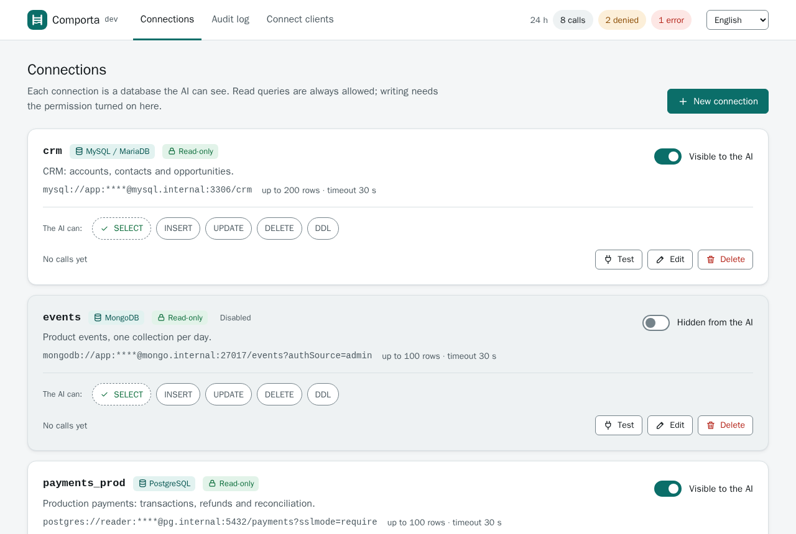
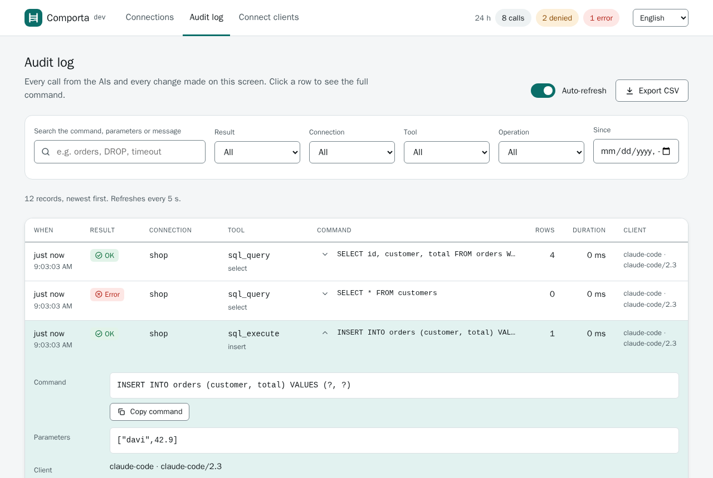
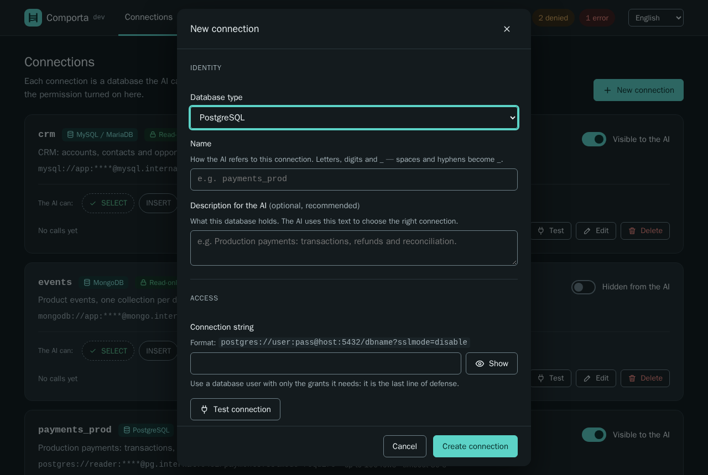
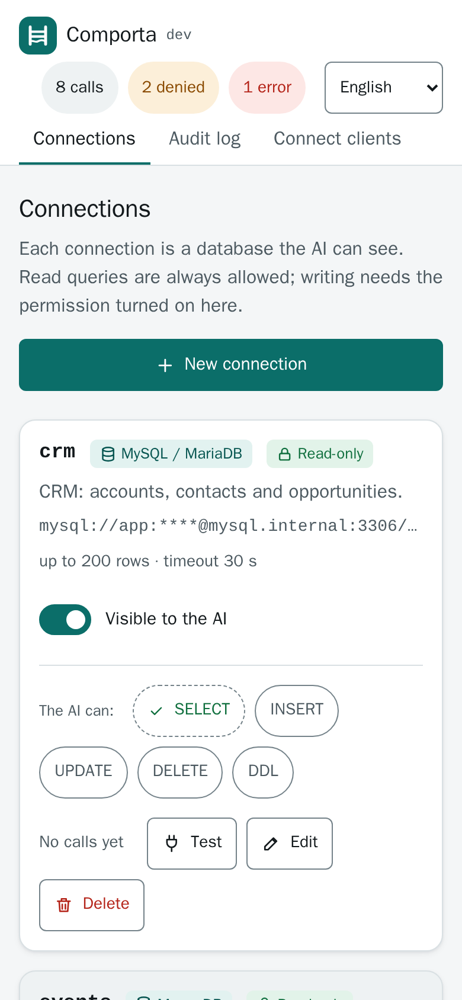

# Comporta

**English** · [Português](README.pt-BR.md)

**One MCP server for all your databases, where you decide what the AI may do in each one.**

Comporta (Portuguese for *sluice gate*) sits between your AI assistants (Claude Code, GitHub Copilot, Gemini…) and your databases: PostgreSQL, SQL Server, MySQL/MariaDB, SQLite and MongoDB. Reads always flow through; writes only flow where you open the gate.

## Quick start with Docker

You need Docker. Three steps, about two minutes.

**1. Create the settings file.** It holds the admin password and one token for your AI client:

```bash
cat > comporta.env <<EOF
COMPORTA_ADMIN_PASSWORD=$(openssl rand -hex 12)
COMPORTA_MCP_TOKENS=claude-code:$(openssl rand -hex 24)
EOF
cat comporta.env   # keep these two values: the password opens the admin UI, the token connects the AI
```

**2. Start Comporta:**

```bash
docker run -d --name comporta --restart unless-stopped \
  --env-file comporta.env \
  -p 127.0.0.1:7843:8080 \
  -v comporta-data:/data \
  slipalison/comporta:latest
```

**3. Open <http://127.0.0.1:7843>**, sign in as `admin` with the password from step 1, and add your first connection. Then connect your AI client:

```bash
claude mcp add --transport http --scope user comporta http://127.0.0.1:7843/mcp \
  --header "Authorization: Bearer <the token after claude-code: in comporta.env>"
```

That's it. Ask your assistant something like *"list the tables in my database"*, then look at the **Audit log** tab.

> **Database on the same machine?** Inside Docker, `localhost` is the container itself. Use `host.docker.internal` in the connection string and add `--add-host host.docker.internal:host-gateway` to `docker run`.

The same image is also on GitHub: `ghcr.io/slipalison/comporta`. Every version is published to both registries with the same digest. Pin a version (`slipalison/comporta:0.1.0`) instead of `latest` in production.

### With Docker Compose

The repository ships a `docker-compose.yml` that runs the container with a read-only filesystem, no Linux capabilities and the port bound to `127.0.0.1`:

```bash
git clone https://github.com/slipalison/comporta.git && cd comporta
cp .env.example .env        # set COMPORTA_ADMIN_PASSWORD and COMPORTA_MCP_TOKENS
docker compose up -d
```

## What you get

- **Per-connection permissions.** Turn `INSERT`, `UPDATE`, `DELETE` and `DDL/Admin` on or off for each database; changes apply to the next AI call. `SELECT` is always allowed.
- **An audit log of every call.** Which client, which connection, the command, its parameters, the result, rows and duration. Filter, open the details, export to CSV.
- **Many databases at once**, each with its own connection pool.
- **A small, locked-down image.** About 10 MB compressed: a static Go binary on distroless, no shell.
- **An admin UI in English and Portuguese**, accessible (WCAG 2.2 AA) and usable on a phone.



| Audit log | New connection, dark theme | Phone |
|---|---|---|
|  |  |  |

## Connecting AI clients

Comporta speaks MCP over Streamable HTTP at `http://127.0.0.1:7843/mcp`. Every request carries `Authorization: Bearer <token>`.

Each client should have its own token. Give each one a label in `COMPORTA_MCP_TOKENS`, separated by commas:

```
COMPORTA_MCP_TOKENS=claude-code:<token-1>,copilot:<token-2>
```

The label shows up in the audit log, so you know which assistant ran each command. The **Connect clients** tab in the UI has ready-to-copy snippets for Claude Code, VS Code / GitHub Copilot (`mcp.json`), Copilot CLI, Gemini CLI and other clients (`mcpServers`).

## Configuration

All settings are environment variables.

| Variable | Default | What it does |
|---|---|---|
| `COMPORTA_ADMIN_PASSWORD` | — (required) | Password of the admin UI (HTTP basic auth). Ten wrong passwords in 5 minutes block that address for 5 minutes. |
| `COMPORTA_ADMIN_USER` | `admin` | User name of the admin UI. |
| `COMPORTA_MCP_TOKENS` | — (required) | `label:token,...`; each token at least 16 characters. `COMPORTA_MCP_TOKEN` works for a single token. |
| `COMPORTA_SECRET_KEY` | random key in `/data/secret.key` | Passphrase that encrypts the stored connection strings (AES-256-GCM, key derived with Argon2id). Changing it later makes the stored connection strings unreadable, and the server refuses to start. |
| `COMPORTA_LOG_RETENTION_DAYS` | `30` | Audit records older than this are deleted every hour. |
| `COMPORTA_MAX_ROWS_CAP` | `1000` | Maximum rows any query may return; each connection sets its own limit below this. |
| `COMPORTA_PORT` | `7843` | Host port, always on `127.0.0.1` (Docker Compose only). |

Keep `comporta.env` (or `.env`) out of the folders your AI agents can read: anyone with the admin password can change the permissions.

### Upgrading from db-mcp

Comporta was called db-mcp before. An existing volume keeps working: `DBMCP_*` variables are still read (the log asks you to rename them), and `dbmcp.db` is still used. On the first start, stored connection strings are re-encrypted in the new format.

Only if db-mcp ran **with** `DBMCP_SECRET_KEY`, start Comporta once with the old key in `COMPORTA_LEGACY_KEY`:

```bash
printf %s "$DBMCP_SECRET_KEY" | sha256sum | cut -c1-64   # this is COMPORTA_LEGACY_KEY
```

After that first start you can remove it. Without it, the server does not start and the log says why.

## What the AI sees

Tools are built from the **active** connections. Each tool's `connection` parameter lists only the connections that tool can use, with their type, SQL dialect, parameter style, description and permissions.

| Tool | Available when |
|---|---|
| `list_connections` | always: name, type, dialect, permissions and which tools to use |
| `describe_schema` | there is any connection: tables and columns (SQL), or collections, sampled fields and indexes (MongoDB) |
| `sql_query` | there is a SQL connection: one `SELECT`/`WITH`/`SHOW`/`EXPLAIN`, in a transaction that is always rolled back |
| `sql_execute` | some SQL connection allows writes; supports `dry_run` |
| `mongo_find`, `mongo_aggregate`, `mongo_count` | there is a MongoDB connection |
| `mongo_insert`, `mongo_update`, `mongo_delete` | a MongoDB connection allows that operation |

**Write a good description for each connection.** It is how the AI picks the right database.

Clients that cache the tool list may need to reconnect after you change a connection. Permissions, however, are checked on every call.

## How permissions are enforced

Three layers, from the gateway down to the database:

1. **A SQL classifier per dialect** (`internal/guard`). It reads comments, strings, Postgres `$$` quotes, T-SQL `[ ]` and MySQL backticks the way each database does. It finds writes hidden in CTEs, `SELECT INTO`, `MERGE`, `EXEC`, `COPY`, `SET`, `OPENQUERY` and similar. One statement per call; anything it cannot prove is a read counts as DDL/Admin. In SQLite, `ATTACH` and `DETACH` are always refused, because they would open other files, including Comporta's own database.
2. **Read-only transactions.** Reads run in `READ ONLY` transactions (Postgres, MySQL) or in a transaction that is always rolled back (SQL Server, SQLite), so a function that writes inside a `SELECT` is stopped by the database itself.
3. **The database user.** The database server is still the last line of defense: use a user with only the grants it needs.

MongoDB operations are structured: `$merge` needs insert and update, `$out` needs insert, delete and DDL, and an update or delete with an empty filter needs `all_documents=true`.

**DDL/Admin is full power** (`DROP`, `EXEC`, `GRANT`, `SET ROLE`…). The UI asks for confirmation before turning on `DELETE` or `DDL`. Leave them off unless you need them.

**The admin UI** decides what the AI may do, so it sits behind a password, listens only on `127.0.0.1`, blocks cross-site requests (CSRF) and runs under a Content Security Policy without `unsafe-inline`.

## The admin UI

- **Languages:** English and Portuguese. Comporta follows your browser's language, and you can switch with the selector at the top; the choice is remembered.
- **Safe by design:** confirmation before allowing destructive writes or deleting a connection, **Undo** after every permission change, and a warning before discarding an edited form.
- **Fast to use:** press `n` for a new connection and `/` to search the audit log. Filters live in the address (`#/audit?status=denied`), so the back button and bookmarks work.
- **Accessible:** checked with axe-core (WCAG 2.2 AA, no violations at 320, 390 and 1440 px, light and dark themes), with keyboard navigation and screen-reader labels. Color contrast is verified by a test (`internal/web/contrast_test.go`).

It was designed with the [UX Laws kit](https://github.com/slipalison/leis-de-ux). The main decisions:

| Law | Where |
|---|---|
| Common region | each connection is a card, with identity, permissions and actions in separate bands |
| Similarity | every permission is the same toggle; "allowed" is a ✓ icon plus color, never color alone; `DELETE` and `DDL` turn red |
| Von Restorff | one primary action per screen ("New connection"); the connection's risk level stands out |
| Fitts | 40 px targets (44 px on touch screens); "Delete" kept away from "Test" and "Edit" |
| Postel | "Payments Prod" is accepted and shown as `payments_prod`; every error appears next to the field that caused it |
| Tesler | the system carries what it knows: a connection-string example for the chosen type, dates sent as absolute instants, 24-hour activity on each connection |

### Adding a language

All texts live in [`internal/web/static/i18n.js`](internal/web/static/i18n.js). Copy the `en` dictionary, translate it, and add the language to `DICTIONARIES` and `LANGUAGES`. A test (`internal/web/i18n_test.go`) fails if a key is missing in any language.

## Development

```bash
go test -race ./...
golangci-lint run ./...          # .golangci.yml: gosec, errorlint, noctx, revive…
go build -o comporta . && COMPORTA_ADMIN_PASSWORD=x COMPORTA_MCP_TOKEN=0123456789abcdef ./comporta
```

| Package | What it does |
|---|---|
| `internal/guard` | SQL classifier |
| `internal/db` | connection pools, SQL and MongoDB execution, schema |
| `internal/mcpsrv` | MCP tools |
| `internal/store` | SQLite store, encryption, audit log |
| `internal/web` | admin API and the embedded UI (no frontend build step) |

**Why Go:** every driver is pure Go (no CGO), so the result is one static binary with the UI embedded, and an image of about 10 MB. The same in Node or Python would be 180 to 400 MB, and SQL Server would need native ODBC libraries.

**CI** runs the shared pipeline from [`slipalison/github-workflows`](https://github.com/slipalison/github-workflows): lint, tests with a coverage floor, the image scanned by Trivy before it is published, Gitleaks, TruffleHog, Semgrep, SBOM, CodeQL, a SonarQube Cloud quality gate, and versions computed from [Conventional Commits](https://www.conventionalcommits.org/).

## License

[MIT](LICENSE)
