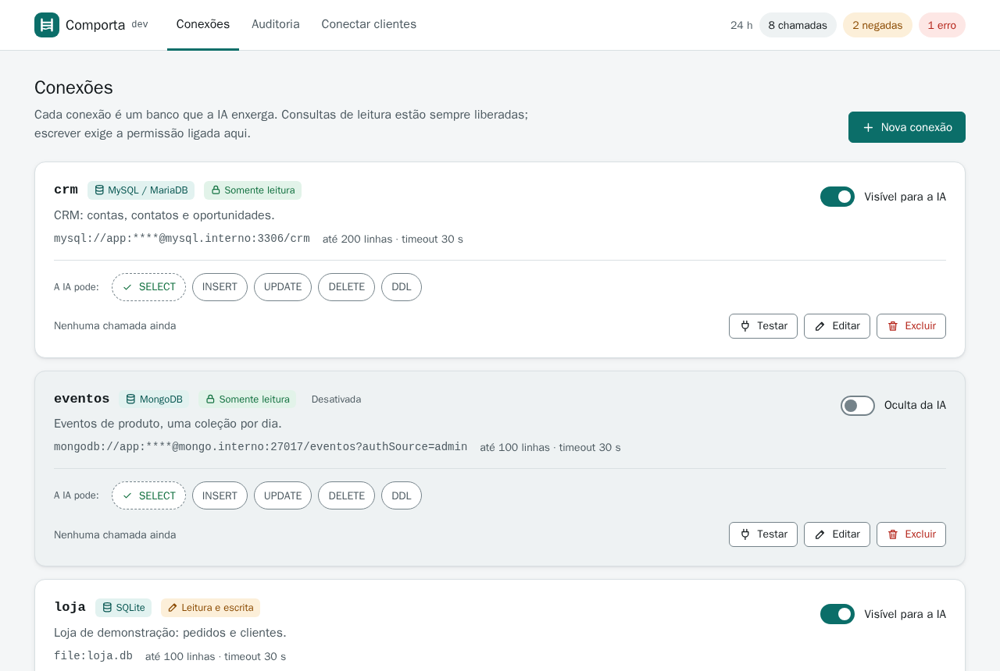
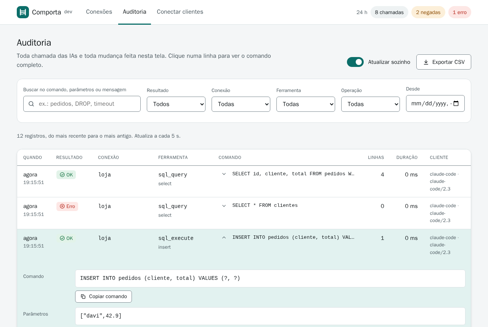
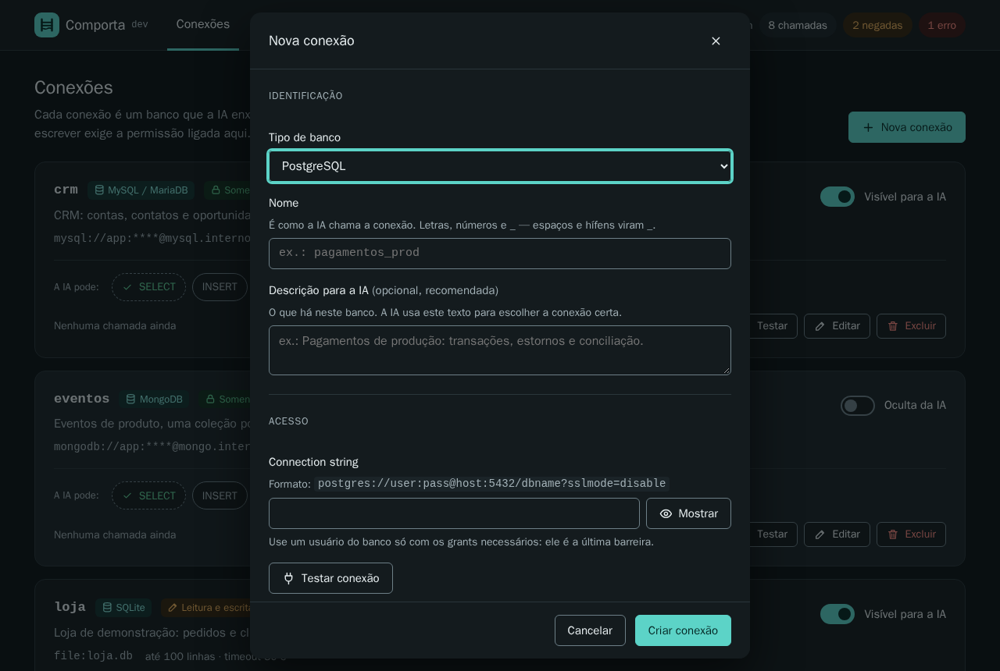
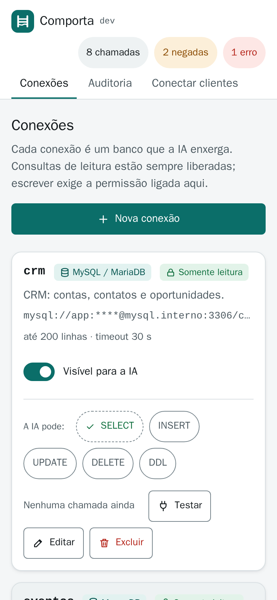

# Comporta

**Um servidor MCP para vários bancos de dados, em que você decide o que a IA pode fazer em cada um.**

Comporta é a porta que controla a passagem da água num canal: abre, fecha, deixa passar só o quanto precisa. Aqui ela fica entre as IAs (Claude Code, Copilot, Gemini…) e os seus bancos — PostgreSQL, SQL Server, MySQL/MariaDB, SQLite e MongoDB — e deixa passar leitura sempre, e escrita só onde você ligou.

- **Permissões por conexão**: `INSERT`, `UPDATE`, `DELETE` e `DDL/Admin` ligam e desligam numa tela, e valem na próxima chamada. `SELECT` está sempre liberado.
- **Auditoria de toda chamada**: qual cliente, qual conexão, o comando, os parâmetros, o resultado, as linhas e a duração. Filtros, detalhe e exportação em CSV.
- **Várias conexões ao mesmo tempo**, cada uma com o seu pool.
- **Imagem de ~10 MB** (≈25 MB descompactada): binário Go estático em distroless, sem shell.



| Auditoria | Nova conexão, tema escuro | Celular |
|---|---|---|
|  |  |  |

## Subir

```bash
cp .env.example .env        # defina COMPORTA_ADMIN_PASSWORD e os tokens (openssl rand -hex 24)
docker compose up -d --build
```

- Interface: <http://127.0.0.1:7843> (usuário e senha do `.env`)
- MCP: `http://127.0.0.1:7843/mcp` (Streamable HTTP, `Authorization: Bearer <token>`)

Para bancos que rodam no host, use `host.docker.internal` no lugar de `localhost` na connection string.

A imagem publicada é `ghcr.io/slipalison/comporta:<versão>`.

### Conectar um cliente

```bash
claude mcp add --transport http --scope user comporta http://127.0.0.1:7843/mcp \
  --header "Authorization: Bearer <token-do-claude-code>"
```

A aba **Conectar clientes** mostra os trechos para VS Code, Copilot CLI, Gemini e outros. Cada token de `COMPORTA_MCP_TOKENS` tem um rótulo (`claude-code:...,copilot:...`) que identifica o cliente na auditoria.

## Configuração

| Variável | Padrão | |
|---|---|---|
| `COMPORTA_ADMIN_USER` / `COMPORTA_ADMIN_PASSWORD` | `admin` / — | Basic auth da interface. A senha é obrigatória. Dez senhas erradas em 5 minutos bloqueiam o endereço por 5 minutos. |
| `COMPORTA_MCP_TOKENS` | — | `rotulo:token,...` (token com 16 caracteres ou mais). Ou `COMPORTA_MCP_TOKEN` para um só. |
| `COMPORTA_SECRET_KEY` | gerada em `/data/secret.key` | Criptografa as connection strings (AES-256-GCM). A chave sai da frase por Argon2id, com um sal guardado em `/data/secret.salt`. Trocar a frase depois torna as connection strings guardadas ilegíveis, e o servidor não sobe. |
| `COMPORTA_LOG_RETENTION_DAYS` | `30` | Registros mais antigos são apagados de hora em hora. |
| `COMPORTA_MAX_ROWS_CAP` | `1000` | Teto global de linhas por consulta; cada conexão tem o seu limite abaixo disso. |
| `COMPORTA_PORT` | `7843` | Porta no host, sempre em `127.0.0.1` (só no `docker compose`). |

**Vindo do `db-mcp`?** As variáveis `DBMCP_*` continuam lidas (com um aviso no log para renomear), e um volume com `dbmcp.db` continua sendo usado. Na primeira partida, as connection strings gravadas pelo `db-mcp` são cifradas de novo no formato novo. Se o `db-mcp` rodava **com** `DBMCP_SECRET_KEY`, a chave dele era o SHA-256 da frase, que o Comporta não calcula mais; informe-a uma vez, só para essa partida:

```bash
# a chave antiga, em hex (o printf é builtin: a frase não aparece no ps)
printf %s "$DBMCP_SECRET_KEY" | sha256sum | cut -c1-64   # vira COMPORTA_LEGACY_KEY
```

Depois da primeira partida a variável pode sair. Sem ela, o servidor não sobe e diz isso no log.

## O que a IA enxerga

As ferramentas são montadas a partir das conexões **ativas**, e o parâmetro `connection` de cada uma é um `enum` só com as conexões válidas para ela, descritas com tipo, dialeto, estilo de parâmetro, descrição e permissões:

| Ferramenta | Quando aparece |
|---|---|
| `list_connections` | sempre: nome, tipo, dialeto, placeholder, permissões e quais ferramentas usar |
| `describe_schema` | há conexões: tabelas e colunas (SQL) ou coleções, campos inferidos e índices (MongoDB) |
| `sql_query` | há conexões SQL: um `SELECT`/`WITH`/`SHOW`/`EXPLAIN`, em transação sempre desfeita |
| `sql_execute` | há conexão SQL com alguma escrita liberada; aceita `dry_run` |
| `mongo_find`, `mongo_aggregate`, `mongo_count` | há conexões MongoDB |
| `mongo_insert` / `mongo_update` / `mongo_delete` | há conexão MongoDB com a permissão correspondente |

Clientes que guardam a lista de ferramentas podem precisar reconectar depois de uma mudança na interface. As permissões, porém, são conferidas a cada chamada.

## Como as permissões são garantidas

1. **Classificador de SQL por dialeto** (`internal/guard`): tokeniza respeitando comentários, strings, `$$` do Postgres, `[ ]` do T-SQL e crases do MySQL; acha escrita escondida em CTE, `SELECT INTO`, `MERGE`, `EXEC`, `COPY`, `SET`, `OPENQUERY` e afins; aceita um statement por chamada. O que ele não reconhece como leitura conta como DDL/Admin. No SQLite, `ATTACH` e `DETACH` são sempre recusados: abririam outro arquivo, inclusive o banco do próprio gateway.
2. **Transação de leitura**: leituras rodam em `READ ONLY` (Postgres, MySQL) ou numa transação sempre desfeita (SQL Server, SQLite). Uma função que escreve dentro de um `SELECT` é barrada pelo próprio banco.
3. **Usuário do banco**: o servidor de banco continua sendo a última barreira. Use na connection string um usuário só com os grants necessários.

No MongoDB as operações são estruturadas: `$merge` exige insert+update, `$out` exige insert+delete+ddl, e update/delete com filtro vazio exigem `all_documents=true`.

**DDL/Admin dá poder total** (`DROP`, `EXEC`, `GRANT`, `SET ROLE`…). A interface pede confirmação antes de ligar `DELETE` ou `DDL`; deixe desligado se não precisar.

**Segurança da interface**: ela decide o que a IA pode fazer, então fica atrás de senha, só em `127.0.0.1`, com proteção CSRF (`http.CrossOriginProtection`) e uma CSP sem `unsafe-inline`. Um agente com acesso ao shell e ao `.env` poderia usar a senha: mantenha o `.env` fora do workspace dos agentes (por exemplo, nas variáveis de ambiente da stack no Portainer).

## A interface

Desenhada com o [kit Leis de UX](https://github.com/slipalison/leis-de-ux) e auditada com axe-core (WCAG 2.2 AA, zero violações em 390, 1440 e 320 px, temas claro e escuro). As decisões principais:

| Lei ou regra | Onde |
|---|---|
| Região comum | cada conexão é um cartão: identificação, permissões e ações em faixas separadas |
| Similaridade | toda permissão é o mesmo botão de alternância; liberado = ícone ✓ + cor, nunca só cor; `DELETE` e `DDL` ligados em vermelho |
| Von Restorff | uma ação primária por tela ("Nova conexão"); o nível de risco da conexão (somente leitura, leitura e escrita, acesso total) em destaque |
| Fitts | alvos de 40 px (44 px em toque); "Excluir" afastado de "Testar" e "Editar" |
| Postel | o nome aceita "Pagamentos Prod" e mostra `pagamentos_prod` ao sair do campo; cada erro volta para o campo que o causou, com o formato esperado |
| Tesler | o sistema absorve o que sabe: exemplo de connection string do tipo escolhido, filtro de data enviado como instante absoluto (sem depender do fuso do servidor), atividade de 24 h em cada conexão |

Também: confirmação antes de liberar escrita destrutiva e de excluir, "Desfazer" em toda troca de permissão, aviso antes de descartar um formulário editado, atalhos `n` (nova conexão) e `/` (busca na auditoria), navegação com o botão voltar (`#/auditoria?status=denied`), e a tabela de auditoria vira cartões no celular. Os pares de cor são verificados por teste (`internal/web/contrast_test.go`).

## Desenvolvimento

```bash
go test -race ./...
golangci-lint run ./...          # .golangci.yml: gosec, errorlint, noctx, revive…
go build -o comporta . && COMPORTA_ADMIN_PASSWORD=x COMPORTA_MCP_TOKEN=0123456789abcdef ./comporta
```

Estrutura: `internal/guard` (classificador SQL), `internal/db` (pools, execução SQL e MongoDB, schema), `internal/mcpsrv` (ferramentas MCP), `internal/store` (SQLite, criptografia, auditoria), `internal/web` (API e interface embutida, sem build de frontend).

### Por que Go

| | Go | Node/TS | Python |
|---|---|---|---|
| Imagem final | **~10 MB** (estático + distroless) | ~180–250 MB | ~250–400 MB (SQL Server via ODBC soma ~100 MB) |
| Drivers | pgx, go-mssqldb, go-sql-driver/mysql, mongo-driver v2, SQLite puro Go (sem CGO) | bons | bons, mas SQL Server exige ODBC nativo |
| SDK MCP | oficial (`modelcontextprotocol/go-sdk`) | oficial | oficial |
| Deploy | 1 binário, interface embutida | `node_modules` | venv e libs nativas |

### CI

A esteira é a de [`slipalison/github-workflows`](https://github.com/slipalison/github-workflows) (`.github/workflows/ci.yml`): lint, testes com piso de cobertura, imagem com portão de vulnerabilidade do Trivy, Gitleaks, TruffleHog, Semgrep, SBOM, CodeQL, SonarQube Cloud com Quality Gate e versão semântica pelos commits ([Conventional Commits](https://www.conventionalcommits.org/pt-br/)).

## Licença

[MIT](LICENSE)
